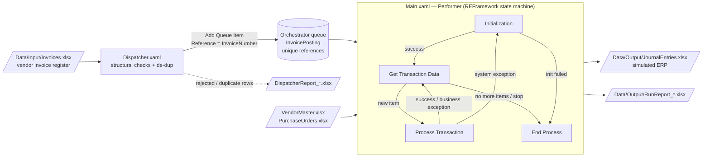

# Invoice Posting Bot — UiPath REFramework (Dispatcher + Performer)

UiPath automation that validates vendor invoices and posts balanced AP journal entries, built on the Robotic Enterprise Framework (REFramework).

The Dispatcher loads a vendor invoice register into an Orchestrator queue, one item per invoice, with the invoice number as the unique reference. The Performer works the queue through the standard REFramework state machine. It checks each invoice against the vendor master and open purchase orders (3-way match with a configurable tolerance), builds a two-line journal entry (Dr expense / Cr Accounts Payable), posts it to a simulated ERP, and records an outcome for every invoice in a run report.

> **All data in this repository is fictional.** The vendors, POs, GL accounts and amounts were made up for this demo and are produced by `tools/generate_test_data.py`. The "ERP" is an Excel journal, so the project runs on any machine with UiPath Studio and needs no external application.

## Status

**Version 1.0 — portfolio project**

- REFramework Performer (`Main.xaml`) and Dispatcher (`Dispatcher.xaml`) built on Studio 25.10 (Windows, VB.NET).
- Runs in two modes, chosen with `RunMode` in `Data/Config.xlsx`:
  - `Local`: no Orchestrator needed. The Performer reads the invoice file directly.
  - `Orchestrator`: the Dispatcher fills the `InvoicePosting` queue and the Performer consumes it.
- 9 Studio test cases, including one data-driven test with 13 cases.
- `tools/validate_project.py` statically checks every workflow: well-formed XAML, invoked files exist, and argument names, directions and types match.

## Business Problem

Accounts Payable teams key vendor invoices into the ERP by hand, and every invoice gets the same checks first:

- Is the vendor real and active?
- Is there a purchase order, and does it belong to this vendor?
- Does the invoice match the PO, and were the goods actually received (3-way match)?
- Is the amount small enough to post without a manager's approval?
- Has this invoice already been posted?

The checks are rule-based and repetitive, and a missed duplicate or an over-billed invoice is a real loss. That makes this a good fit for an unattended bot. Clean invoices post automatically, and every exception is routed to a person with a clear reason.

## Architecture



### Current End-to-End Flow

```text
Dispatcher.xaml
│
├── InitAllSettings          (Config.xlsx → Config dictionary, assets with local fallback)
├── LoadInvoices             (blank invoice #, non-numeric amount, bad date, duplicate in file)
├── Add Queue Item × N       (Reference = InvoiceNumber; unique-reference violations logged + skipped)
└── DispatcherReport_*.xlsx

Main.xaml (Performer)
│
├── Initialization
│     ├── InitAllSettings + KillAllProcesses        (first run only)
│     ├── LoadInvoices                              (Local mode only)
│     └── InitAllApplications                       (vendor master + open POs)
│
├── Get Transaction Data   → Framework/GetTransactionData.xaml
│
├── Process Transaction    → Framework/Process.xaml
│     ├── Processing/ValidateInvoice.xaml           (business rules → BusinessRuleException)
│     ├── Processing/BuildJournalEntry.xaml         (Dr expense GL / Cr AP, must balance)
│     ├── Posting/PostJournalEntry.xaml             (append to journal, skip if JournalId exists)
│     └── Framework/SetTransactionStatus.xaml       (queue status, run report, retry logic)
│
└── End Process            → CloseAllApplications (KillAllProcesses on failure)
```

## REFramework States

| State | What it does in this bot | Leaves to |
|---|---|---|
| **Initialization** | First run: reads `Data/Config.xlsx`, sets the run report path, and kills configured processes. In Local mode it loads and pre-validates `Invoices.xlsx`. Every run (including after a system exception) it reloads the vendor master and open POs, and it stops the job if `MaxConsecutiveSystemExceptions` is reached. | Get Transaction Data, or End Process if init fails |
| **Get Transaction Data** | Checks **Should Stop**. Then it gets the next queue item (Orchestrator mode), or wraps row *N* of the validated invoice table in a `QueueItem` with the same `SpecificContent` keys (Local mode), so `Process.xaml` is identical in both modes. | Process Transaction, or End Process when there is no more data |
| **Process Transaction** | Validates the invoice, builds the journal, posts it, then calls `SetTransactionStatus.xaml`. | Get Transaction Data (success or business exception), or Initialization (system exception) |
| **End Process** | Closes applications (and kills processes if that fails). Re-throws an initialization failure so the job ends **Faulted** in Orchestrator. | — (final state) |

## Business Rules (Processing/ValidateInvoice.xaml)

The rules run in this order, and the first failure throws a `BusinessRuleException`:

1. Amount must be greater than zero, so a credit memo keyed as an invoice is not auto-posted.
2. The vendor must exist in the vendor master and be **Active**.
3. A PO number is required, because non-PO invoices go to manual approval.
4. The PO must exist and belong to the same vendor.
5. **Invoice-to-PO variance** must be within `MatchTolerancePercent`. The default is 2%.
6. **3-way match:** the invoice may not exceed the received amount (plus tolerance).
7. The amount must be at or below `MaxAutoPostAmount`. Larger invoices need human approval.

A passing invoice becomes journal `AP-<InvoiceNumber>`, which debits the vendor's default expense GL and credits AP `2000-00`. `BuildJournalEntry.xaml` throws a system exception if the entry does not balance.

## Configuration (Data/Config.xlsx)

`Framework/InitAllSettings.xaml` loads the **Settings** and **Constants** sheets as Name → Value pairs. For the **Assets** sheet, it first stores `LocalValue` and then tries **Get Orchestrator Asset**. When the robot is not connected, or the asset doesn't exist, it logs a warning and keeps the local value.

| Sheet | Name | Default | Purpose |
|---|---|---|---|
| Settings | `RunMode` | `Local` | `Local` = read the invoice file directly; `Orchestrator` = use the queue |
| Settings | `OrchestratorQueueName` | `InvoicePosting` | Queue filled by the Dispatcher and consumed by the Performer |
| Settings | `OrchestratorQueueFolder` | *(blank)* | Orchestrator folder; blank = robot's default folder |
| Settings | `InvoiceInputPath` / `InvoiceSheetName` | `Data\Input\Invoices.xlsx` / `Invoices` | Invoice register |
| Settings | `VendorMasterPath` / `VendorSheetName` | `Data\Input\VendorMaster.xlsx` / `Vendors` | Vendor status + default expense GL |
| Settings | `PurchaseOrdersPath` / `PurchaseOrderSheetName` | `Data\Input\PurchaseOrders.xlsx` / `PurchaseOrders` | PO and received amounts |
| Settings | `JournalOutputPath` / `JournalSheetName` | `Data\Output\JournalEntries.xlsx` / `JournalEntries` | Simulated ERP ledger |
| Settings | `RunReportFolder` | `Data\Output` | Run and dispatcher reports |
| Settings | `ProcessesToKill` | *(blank)* | Comma-separated; blank = kill nothing |
| Constants | `MaxRetryNumber` | `2` | Local-mode retries per system exception (use 0 + queue Auto Retry in Orchestrator) |
| Constants | `MaxConsecutiveSystemExceptions` | `3` | Stop the job after this many system exceptions in a row |
| Constants | `APAccount` | `2000-00` | AP control account credited on every journal |
| Constants | `JournalPrefix` | `AP` | Journal ID prefix |
| Constants | `ExScreenshotsFolderPath` | `Exceptions_Screenshots` | Screenshot folder on system exceptions |
| Assets | `MatchTolerancePercent` | asset `InvoicePosting_MatchTolerancePercent`, LocalValue `2` | Allowed invoice vs PO/receipt variance (%) |
| Assets | `MaxAutoPostAmount` | asset `InvoicePosting_MaxAutoPostAmount`, LocalValue `25000` | Above this, route for approval |

## Exception Handling Strategy

| Type | Examples | Handling |
|---|---|---|
| **Business exception** (`BusinessRuleException`) | Unknown or inactive vendor, missing PO, over tolerance, 3-way match failure, over the auto-post limit | Queue item set to **Failed / Business** with the reason. Logged at **Warn** and written to the run report. **Never retried**, because the data is wrong and a retry would only fail again. Next transaction. |
| **System exception** (any other exception) | Locked or missing file, unreadable workbook, out-of-balance journal | Logged at **Error**. Takes a screenshot, closes apps (or kills processes), and goes back to **Initialization** to reload reference data. **Local mode:** retries the same row up to `MaxRetryNumber`. **Orchestrator mode:** sets the item to **Failed / Application** so the queue's Auto Retry decides (no double retry). |
| **Too many in a row** | `MaxConsecutiveSystemExceptions` reached | Initialization throws, End Process re-throws, and the job ends **Faulted** instead of failing every remaining item. |
| **Duplicate posting** | Re-running the Dispatcher; a retry after a partial run | Dispatcher: in-file de-duplication **plus** the queue's unique reference. Performer: `PostJournalEntry.xaml` skips the append if `AP-<InvoiceNumber>` is already in the ledger. |
| **Anything unhandled** | Errors outside the framework Try Catches | `GlobalHandlerX.xaml` logs the activity and exception, then re-throws (**Continue**). It does not retry, because retrying a posting step from a global handler risks a double post. |

Log levels follow one rule: **Info** for milestones and successes, **Warn** for business exceptions and fallbacks, **Error** for system exceptions, and **Fatal** when the run stops. Every transaction log line includes the invoice number.

## Testing

Test cases live in `Tests/` and are registered as Studio **Test Cases** in `project.json`, so they appear in Test Explorer. Each one follows **Given / When / Then** and uses **Verify Expression** from `UiPath.Testing.Activities`.

| Test case | What it proves |
|---|---|
| `Test_InitAllSettings` | Config.xlsx loads Settings, Constants and Assets, and the asset falls back to `LocalValue` without Orchestrator |
| `Test_ValidateInvoice_HappyPath` | A clean PO invoice passes and returns the vendor's expense GL |
| `Test_ValidateInvoice_UnknownVendor` | Vendor not in the master → `BusinessRuleException` |
| `Test_ValidateInvoice_NegativeAmount` | Negative amount → `BusinessRuleException` |
| `Test_ValidateInvoice_MissingPO` | Blank PO → `BusinessRuleException` |
| `Test_ValidateInvoice_OverTolerance` | 15% over PO → `BusinessRuleException` |
| `Test_ValidateInvoice_DataDriven` | 13 cases from `Tests/TestData/ValidateInvoice_Cases.xlsx`, including the tolerance boundary (exactly 2% passes, 2.03% fails), inactive vendor, PO/vendor mismatch, partial receipt and auto-post limit |
| `Test_BuildJournalEntry` | Two lines, correct accounts, JournalId, and debits = credits |
| `Test_PostJournalEntry_NoDoublePosting` | Posting the same journal twice writes it once (protects retries) |

Expected end-to-end results for the sample data are in [`docs/expected-results.md`](docs/expected-results.md): **6 posted, 8 business exceptions, 1 in-file duplicate, 2 rejected rows**, and 12 journal lines. They are produced by `tools/simulate_expected_results.py`, a plain-Python model of the same rules, so a Studio run can be checked against them.

Static checks, which don't need Studio:

```bash
pip install openpyxl lxml
python tools/validate_project.py
```

## How to Run

**Requirements:** UiPath Studio **25.10** or later (Windows project, VB.NET). Studio restores the dependencies listed in `project.json`: `UiPath.System.Activities`, `UiPath.Excel.Activities`, `UiPath.Testing.Activities` and `UiPath.UIAutomation.Activities`. Excel does not need to be installed, because only Workbook activities are used.

### Option A — Local (no Orchestrator)

1. Clone the repo and open `project.json` in Studio.
2. Leave `RunMode = Local` in `Data/Config.xlsx`.
3. Run `Main.xaml`.
4. Open `Data/Output/JournalEntries.xlsx` and `Data/Output/RunReport_*.xlsx` and compare them with `docs/expected-results.md`.
5. To reset, delete the files in `Data/Output/`. To regenerate the inputs, run `python tools/generate_test_data.py`.

### Option B — Orchestrator (Dispatcher + Performer)

1. In Orchestrator, create the queue **`InvoicePosting`** with **Enforce unique references** enabled. Set Auto Retry (for example 1–2) for application exceptions.
2. Optionally, create the assets `InvoicePosting_MatchTolerancePercent` (Integer/Text) and `InvoicePosting_MaxAutoPostAmount`.
3. Set `RunMode = Orchestrator` and `MaxRetryNumber = 0` in `Data/Config.xlsx`. In queue mode the queue owns retries.
4. Run **`Dispatcher.xaml`**, then **`Main.xaml`**. Both are entry points, so publish once and create one process per entry point.
5. Run the Dispatcher again on the same file. Every invoice is reported as **Duplicate**, because the unique reference blocks it.

## Project Structure

```text
Main.xaml                          Performer: REFramework state machine
Dispatcher.xaml                    Dispatcher: invoice register → InvoicePosting queue
GlobalHandlerX.xaml                Global exception handler (log + re-throw)

Framework/
    InitAllSettings.xaml           Config.xlsx → Config dictionary (assets w/ local fallback)
    InitAllApplications.xaml       Load vendor master + open POs, ensure output folders
    GetTransactionData.xaml        Queue item (Orchestrator) or row N as QueueItem (Local)
    Process.xaml                   Validate → build journal → post
    SetTransactionStatus.xaml      Success / business / system handling + run report
    RetryCurrentTransaction.xaml   Retry policy (local retries vs queue Auto Retry)
    CloseAllApplications.xaml      Graceful close (placeholder for an ERP logout)
    KillAllProcesses.xaml          Config-driven last-resort cleanup
    TakeScreenshot.xaml            Screenshot on system exceptions

Dispatcher/
    LoadInvoices.xaml              Structural checks, in-file de-dup, normalization
Processing/
    ValidateInvoice.xaml           Business rules (BusinessRuleException)
    BuildJournalEntry.xaml         Balanced Dr expense / Cr AP lines
Posting/
    PostJournalEntry.xaml          Append to the simulated ERP; skip already-posted journals
Reporting/
    WriteRunReport.xaml            One status line per invoice

Tests/
    Test_*.xaml                    9 Studio test cases (Given / When / Then)
    TestData/ValidateInvoice_Cases.xlsx

Data/
    Config.xlsx                    Settings / Constants / Assets
    Input/Invoices.xlsx            17 fictional invoices incl. edge cases
    Input/VendorMaster.xlsx        6 fictional vendors (1 inactive)
    Input/PurchaseOrders.xlsx      10 fictional POs (1 partially received)
    Output/                        Journal + reports (git-ignored)

tools/
    generate_test_data.py          Rebuilds all sample data (openpyxl)
    simulate_expected_results.py   Python model of the rules → docs/expected-results.md
    validate_project.py            Static XAML / project.json checks

docs/
    expected-results.md
    screenshots/                   Studio screenshots (see docs/screenshots/README.md)

project.json · project.uiproj · entry-points.json
```

## Sample Data

The invoice register mixes clean invoices with one of each edge case:

| Scenario | Invoice | Expected |
|---|---|---|
| Clean PO invoices | INV-10001–10004, INV-10014 | Posted |
| Within tolerance (+0.67%) | INV-10005 | Posted |
| Duplicate invoice number | INV-10002 (2nd copy) | Skipped by Dispatcher |
| Missing PO | INV-10006 | Business exception |
| Unknown vendor | INV-10007 | Business exception |
| Negative amount | INV-10008 | Business exception |
| Over tolerance (+15%) | INV-10009 | Business exception |
| Inactive vendor | INV-10010 | Business exception |
| PO belongs to another vendor | INV-10011 | Business exception |
| Above auto-post limit | INV-10012 | Business exception |
| Goods only half received | INV-10013 | Business exception (3-way match) |
| Blank invoice number / amount "TBD" | rows 17–18 | Rejected by Dispatcher |

## Source Control / Data Safety

- Every vendor, PO, account and amount is **fictional**. No production data, credentials or employer systems appear in this project.
- `Data/Output/`, Studio caches (`.local`, `.screenshots`, `.storage`, `.settings`, `.project`), Autosaved files and runtime error pages are git-ignored.
- `excludedLoggedData` in `project.json` keeps `Private:*` and `*password*` values out of the logs.

## What I'd Add Next

1. **Document Understanding for PDF invoices:** replace the Excel register with a Digitize → Classify → Extract pipeline, and send low-confidence fields to **Validation Station** before the Dispatcher queues them.
2. **Agentic exception triage with a human in the loop:** a UiPath Agent reads each business exception (reason, invoice and PO data) and proposes an action, such as "request a receiving update" or "route to the approver". It creates an **Action Center** task, and the bot posts only after a person approves.
3. **Real ERP posting:** swap `PostJournalEntry.xaml` for an API call or UI automation against an ERP sandbox, keeping the JournalId duplicate check.
4. **Queue-item analytics:** `SetTransactionStatus` already passes `JournalId` as queue output. Adding vendor, amount and exception category would let an Insights dashboard show touchless rate and exception reasons.
5. **CI:** run `tools/validate_project.py` and UiPath CLI test execution on every push.

## Author

**Chris Roberts** — staff accountant and UiPath RPA developer. [GitHub](https://github.com/Chris1112220)

Licensed under the [MIT License](LICENSE).
